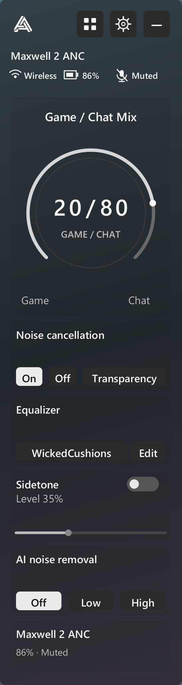
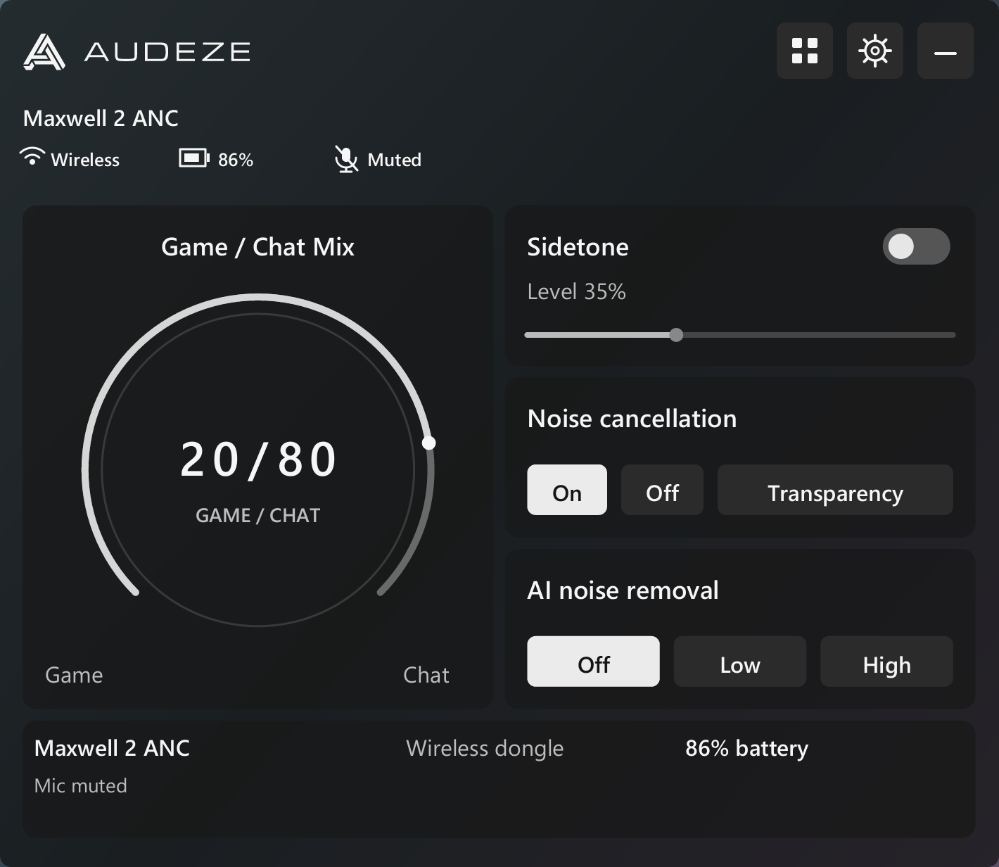
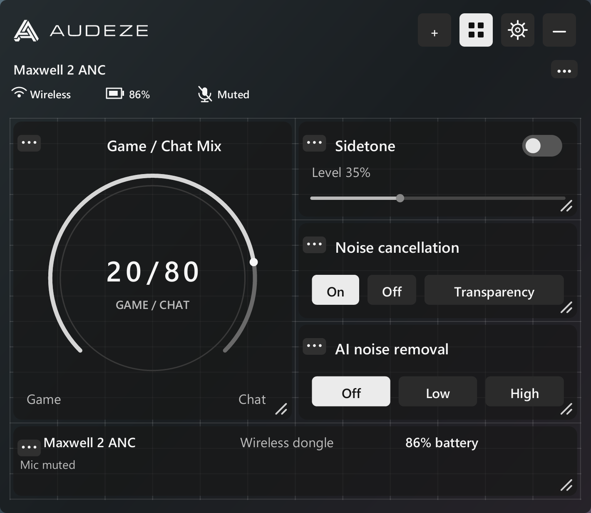
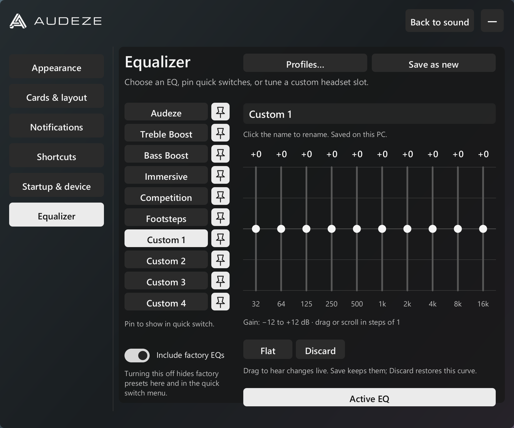
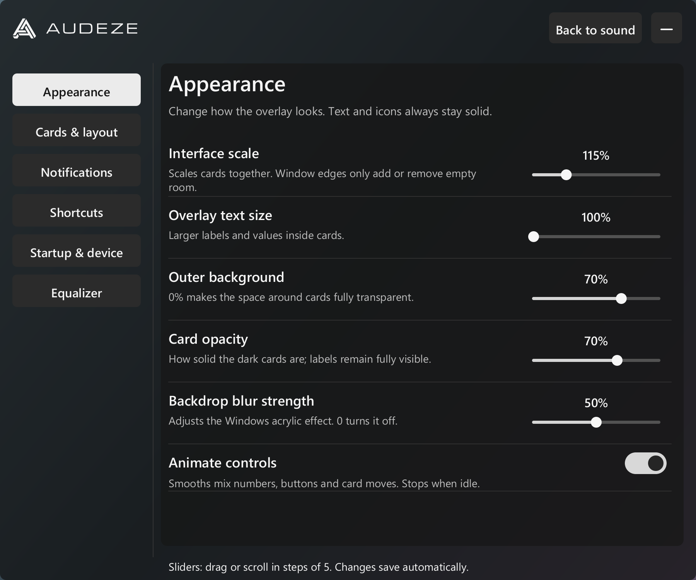

# Audeze Overlay

**See what your headset is doing. Keep the game in focus.**

A lightweight, native Rust overlay for Audeze Maxwell headset controls. Turn the
game/chat wheel and get a visual readout, or open the panel to adjust sound and EQ.
It talks directly to the USB dongle, so **Audeze App can stay closed**.

Development builds also include experimental wired USB and additional Maxwell
profiles. See the [coverage and validation matrix](docs/DEVICE_PROTOCOL.md);
additional hardware is not yet verified and non-ANC custom EQ editing is disabled.

**[Download for Windows — installer](https://github.com/temdah/AudezeOverlay/releases/latest/download/Audeze-Overlay-Setup.exe)** ·
[Portable ZIP](https://github.com/temdah/AudezeOverlay/releases/latest/download/Audeze-Overlay-Portable.zip) ·
[What's new](https://github.com/temdah/AudezeOverlay/releases/latest) ·
[Documentation](docs/README.md)

## One overlay, your layout

Go slim and translucent, or keep the original stacked cards. Resize, rearrange,
and hide controls to fit your screen. The fixed status row keeps the headset
model, wireless connection, battery and microphone state in view.

<table>
<tr><th>Vertical · subtle cards</th><th>Original · stacked cards</th></tr>
<tr>
<td valign="top"></td>
<td valign="top">
<strong>Vertical:</strong> 100% interface and text scale, 50% outer background, 10% card opacity, 50% backdrop blur.

<strong>Original:</strong> default card layout, 70% outer background, 70% card opacity, 50% backdrop blur.

Both have the status row enabled and layout editing turned off. Text and icons stay solid as the panels become more transparent.
</td>
</tr>
</table>

*Rendered by the application with sample readings and the public font fallback.
These previews use a neutral backdrop to show panel opacity; live Windows blur
depends on what is behind the overlay.*

## Built to stay small

**About 82% less resident memory than Audeze App in our local comparison.**
The overlay averaged **19.48 MiB** while visible, compared with **105.85 MiB** for
the official app. It runs independently, with no web runtime or permanent render
loop.

| Visible, connected application | Audeze Overlay | Audeze App |
| --- | ---: | ---: |
| Resident memory | **19.48 MiB** | 105.85 MiB |
| Private committed memory | **7.17 MiB** | 151.49 MiB |
| CPU, percentage of one logical core | **0.103%** | 1.314% |

Measured on 10 October 2026 using Overlay 0.4.1 and Audeze App 1.2.48 on Windows 11
with a Ryzen 7 9800X3D. Each figure averages two approximately 30-second samples.
Memory savings were consistent; **CPU results varied between runs**, including a
preliminary run with the opposite visible-CPU ordering. These figures do not
establish an FPS improvement, zero game impact, or lower physical input latency.
The official app also provides more features, including firmware management.

[Read the measurements, limitations and reproduction steps →](docs/PERFORMANCE.md)

## Your sound, within reach

- **Game/chat balance:** circular dial with visual feedback for physical wheel
  changes. Drag, scroll, or double-click to return to 50/50.
- **Sound controls:** sidetone, ANC/Transparency, and microphone noise removal.
- **Live EQ:** tune ten bands, switch presets, and pin your favorites. Save keeps
  your curve; Discard restores the curve from before editing. Import profiles,
  export portable files, and save a new copy in your local preset library.
- **Useful status:** headset model, connection, battery, and microphone mute.
- **Your layout:** move the overlay, resize and rearrange cards, or hide what you
  do not need.
- **Stay out of the way:** configurable popups, show/hide shortcut, tray controls,
  background/card transparency, and Windows blur.

| Arrange your controls | Tune your EQ |
| --- | --- |
|  |  |

Live EQ writes to the headset immediately. Keep the app open until you Save or
Discard; exiting before Discard leaves the latest applied curve on the headset.

Appearance and settings preview

Choose the information you want, how long notifications remain visible, and the
shortcut that opens the panel. [Full settings and controls guide](docs/USER_GUIDE.md).

## Get started

1. Install with **Audeze-Overlay-Setup.exe**, or extract the portable ZIP and run
   **Audeze Overlay.exe**.
2. Connect your supported headset through its USB dongle.
3. Press **Alt + Home** to show or hide the panel. Open Settings to record your
   preferred shortcut; the tray also provides Open, Reset position, and Quit.

**Hardware tested:** Maxwell 2 ANC PlayStation dongle (`3329:4BA9`) on Windows 11,
plus wired status reads and mix recovery across cable changes (`3329:4BAA`).
Other Maxwell identities and wired EQ editing remain experimental. Bluetooth is
limited to Windows connection status, with no Bluetooth sound controls.
See the [validation matrix](docs/DEVICE_PROTOCOL.md) before trying another model.
Use borderless/windowed games;
exclusive fullscreen can prevent ordinary desktop overlays from appearing.
Packages are currently unsigned.

The overlay uses a separate desktop window, with no game injection, graphics
hooks, game-memory access, or custom driver. **Anti-cheat vendor approval and
universal compatibility are not claimed.**

## Learn more and contribute

[User guide](docs/USER_GUIDE.md) · [Performance](docs/PERFORMANCE.md) ·
[Device and compatibility details](docs/DEVICE_AND_COMPATIBILITY.md) ·
[Build and release guide](docs/DEVELOPMENT.md) ·
[Architecture](docs/ARCHITECTURE.md) · [Contributing](CONTRIBUTING.md)

Independent community project, not affiliated with or endorsed by Audeze.
Code is licensed under [MIT](LICENSE). Audeze branding retains its original
ownership; see [third-party notices](THIRD-PARTY-NOTICES.md).
